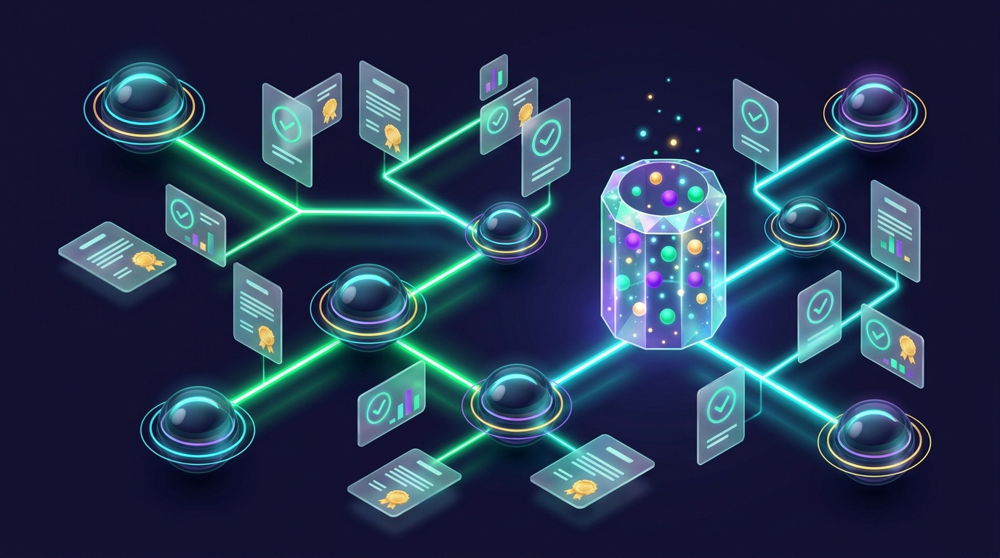

<!--
SEO METADATA
Meta Title: Manchester City Financial Rules Breach in 2026: How Legal, Audit & Finance Teams Use AI Agents, Hybrid RAG & MCP for Instant Compliance
Meta Description: As Manchester City financial rules breach news tops UK Google Trends, discover how legal, audit, and finance teams automate document review and compliance with LangGraph AI agents, Hybrid RAG, MCP servers, AI SaaS apps, and hardened WordPress sites via Novtek (https://novtek.co.uk/) and Fiverr (@mabdullahkh).
Target Keywords: manchester city financial rules breach, uk regtech ai, AI Compliance Agents, LangGraph, Hybrid RAG, Model Context Protocol MCP, AI SaaS, Secure WordPress UK, Novtek, mabdullahkh Fiverr
Medium Tags: Manchester City, Fintech, Artificial Intelligence, AI Agents, SaaS
-->

# Manchester City Financial Rules Breach in 2026: How Legal, Audit & Finance Teams Use AI Agents, Hybrid RAG & MCP for Instant Compliance

When **Manchester City financial rules breach** headlines surge to the top of UK Google Trends, it puts a spotlight on just how complex modern financial governance has become—spanning thousands of pages of sponsorship contracts, accounting ledgers, and regulatory rulebooks.

In 2026, UK legal firms, accounting practices, sports organizations, and fintech startups can’t rely on manual spreadsheet reviews or generic chatbots that hallucinate clauses. Forward-thinking teams partner with **[Novtek](https://novtek.co.uk/)** (led by Senior AI & Full-Stack Engineer **Muhammad Abdullah**, **[@mabdullahkh on Fiverr](https://www.fiverr.com/mabdullahkh)**) to build **citation-backed AI audit agents**, **live MCP compliance portals**, and **enterprise-hardened web platforms**.

---

## 1. Zero-Hallucination Document & Rulebook Audits (LangGraph + Hybrid RAG)

Reviewing 100,000+ pages of contracts, invoices, and regulatory filings manually takes months. By deploying **stateful LangGraph & CrewAI agents** backed by **Hybrid RAG** (**Pinecone, Qdrant, pgvector**), your team can cross-reference clauses, flag anomalies, and generate citation-backed summaries in seconds using **GPT-4o**, **Claude 3.7 Sonnet**, and **Gemini**.

👉 **Automate your document & compliance workflows:** Order Gig #1 on Fiverr:
**[AI Automation Using LangChain, LangGraph, RAG & AI Agents (@mabdullahkh) →](https://www.fiverr.com/mabdullahkh/ai-automation-using-langchain-langgraph-rag-ai-agents)** (or explore all services at **[novtek.co.uk](https://novtek.co.uk/#fiverr-gigs)**).

---

## 2. Live Ledger & Audit Trail Sync via MCP & Custom AI SaaS

Static RAG only reads uploaded files. Connecting **Model Context Protocol (MCP)** servers directly to **live PostgreSQL/MongoDB databases, ERP systems, Slack, and Stripe** lets your **Python (FastAPI / Django) + Next.js / React** RegTech or SaaS platform verify transactions and produce real-time audit logs safely.

- **AI-Native Audit Portals & Live MCP Connectors:** **[Create AI Websites & Web Apps Using LangChain, RAG & MCP →](https://www.fiverr.com/mabdullahkh/ai-website-ai-web-application-ai-software-as-full-stack-website-developer)**
- **Custom RegTech & AI SaaS Platforms:** **[Develop AI-Powered Web Applications, Custom Software & AI Agents →](https://www.fiverr.com/mabdullahkh/develop-ai-powered-web-applications-custom-software-and-full-stack-websites)**

---

## 3. High-Trust Corporate & Legal Websites (WordPress & Full-Stack MERN)

When UK clients search for legal, audit, or financial advisory expertise, your website must project authority, load in under a second, and stay locked down. With **7+ years of experience**, **[Novtek](https://novtek.co.uk/)** builds hardened, SEO-first **WordPress** sites (Elementor, Bricks, Divi, LiteSpeed Cache, Yoast/Rank Math SEO, Wordfence) and **MERN stack** apps.

👉 **Upgrade your UK firm’s website today:** Book Gig #4 on Fiverr:
**[Modern WordPress Website Design or Redesign & Full-Stack Dev →](https://www.fiverr.com/mabdullahkh/be-your-mern-stack-developer-with-sql-and-nonsql-databases)**

---

## Ready to Build High-Trust AI & Web Software?

Visit **[https://novtek.co.uk/](https://novtek.co.uk/)** or message **[@mabdullahkh on Fiverr](https://www.fiverr.com/mabdullahkh)** today to launch your AI agents, MCP integrations, SaaS app, or high-speed WordPress site with 5.0★ verified quality and 100% Fiverr escrow protection.

