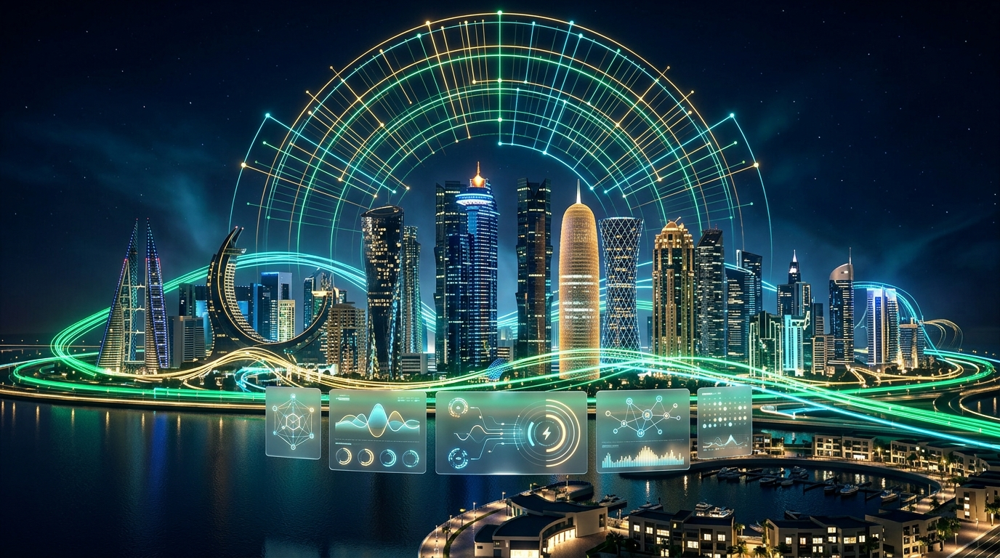
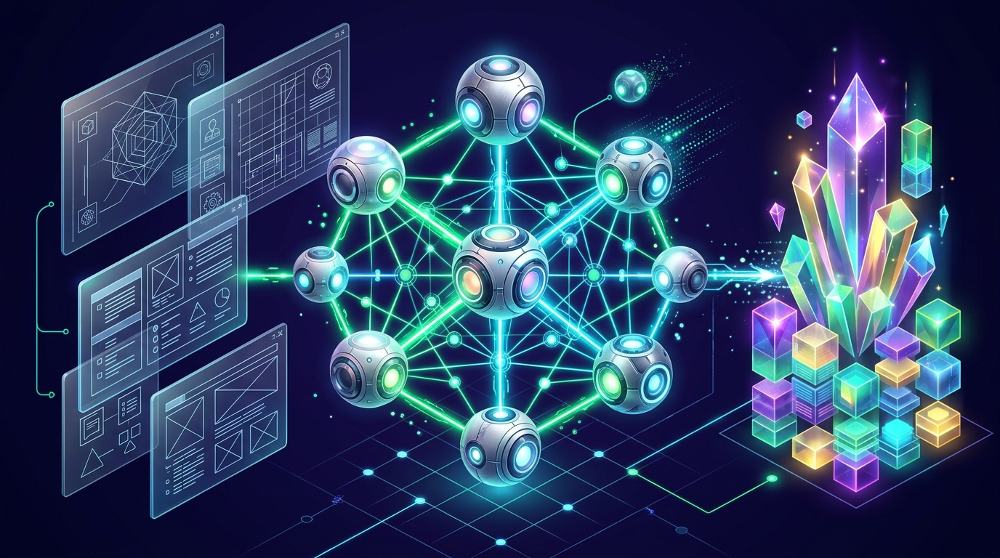

<!--
SEO METADATA
Meta Title: Qatar Kahramaa Infrastructure & Gulf Smart-City Surge in 2026: How GCC Enterprises Scale with AI Agents, Hybrid RAG & MCP
Meta Description: As Qatar Kahramaa infrastructure project news trends across the Gulf alongside UAE aviation and banking growth, discover how GCC enterprises scale with LangGraph AI agents, Hybrid RAG, MCP servers, AI SaaS apps, and fast WordPress websites via Novtek (https://novtek.co.uk/) and Fiverr (@mabdullahkh).
Target Keywords: qatar kahramaa infrastructure project, gulf smart city ai, qatar uae ai automation, LangGraph, Hybrid RAG, Model Context Protocol MCP, AI SaaS, WordPress GCC, Novtek, mabdullahkh Fiverr
Medium Tags: Qatar, Smart Cities, Artificial Intelligence, AI Agents, SaaS
-->

# Qatar Kahramaa Infrastructure & Gulf Smart-City Surge in 2026: How GCC Enterprises Scale with AI Agents, Hybrid RAG & MCP

When news of a major **Qatar Kahramaa infrastructure project** trends across Gulf search charts—alongside massive digital momentum in UAE aviation and banking—it highlights how rapidly GCC nations are investing in **next-generation smart grids, utilities, and enterprise automation.**

For engineering contractors, GovTech vendors, and fast-growing startups across **Qatar, the UAE, and Saudi Arabia**, winning in 2026 requires more than traditional portals. Leading GCC organizations partner with **[Novtek](https://novtek.co.uk/)** (led by Senior AI & Full-Stack Engineer **Muhammad Abdullah**, **[@mabdullahkh on Fiverr](https://www.fiverr.com/mabdullahkh)**) to deploy **autonomous AI agents**, **live-data MCP platforms**, and **high-speed enterprise websites**.

---

## 1. Tender, RFP & Engineering AI Agents (LangGraph + Hybrid RAG)

Mega-infrastructure projects generate tens of thousands of pages of technical specs, MEP drawings, safety standards, and tender documents. By deploying **stateful LangGraph & CrewAI agents** backed by **Hybrid RAG** (**Pinecone, Qdrant, pgvector**), your engineering and procurement teams can query PDFs, DOCX files, and compliance manuals in seconds with zero hallucinations using **GPT-4o**, **Claude 3.7 Sonnet**, and **Gemini**.

👉 **Automate your RFP, engineering, and enterprise workflows:** Order Gig #1 on Fiverr:
**[AI Automation Using LangChain, LangGraph, RAG & AI Agents (@mabdullahkh) →](https://www.fiverr.com/mabdullahkh/ai-automation-using-langchain-langgraph-rag-ai-agents)** (or explore all services at **[novtek.co.uk](https://novtek.co.uk/#fiverr-gigs)**).

---

## 2. Live Grid, ERP & Portal Integrations via MCP & Custom AI SaaS

Connecting **Model Context Protocol (MCP)** servers directly to **live PostgreSQL/MongoDB databases, ERP systems, Slack, and Stripe** transforms a **Python (FastAPI / Django) + Next.js / React** application into a real-time **AI SaaS** command center for field operations, asset tracking, and client portals.

- **AI-Native Enterprise Portals & Live MCP Connectors:** **[Create AI Websites & Web Apps Using LangChain, RAG & MCP →](https://www.fiverr.com/mabdullahkh/ai-website-ai-web-application-ai-software-as-full-stack-website-developer)**
- **Custom GCC AI SaaS Platforms & Dashboards:** **[Develop AI-Powered Web Applications, Custom Software & AI Agents →](https://www.fiverr.com/mabdullahkh/develop-ai-powered-web-applications-custom-software-and-full-stack-websites)**

---

## 3. High-Trust GCC Corporate Websites (WordPress & Full-Stack MERN)

Whether you’re bidding on Gulf infrastructure contracts or launching a regional fintech or e-commerce brand, your digital presence must load in under a second and rank on Google. With **7+ years of experience**, **[Novtek](https://novtek.co.uk/)** builds enterprise-hardened, SEO-first **WordPress** websites (Elementor, Bricks, Divi, LiteSpeed Cache, Yoast/Rank Math SEO, Wordfence) and **MERN stack** apps.

👉 **Upgrade your corporate website today:** Book Gig #4 on Fiverr:
**[Modern WordPress Website Design or Redesign & Full-Stack Dev →](https://www.fiverr.com/mabdullahkh/be-your-mern-stack-developer-with-sql-and-nonsql-databases)**

---

## Ready to Build for the Gulf’s Digital Future?

Visit **[https://novtek.co.uk/](https://novtek.co.uk/)** or message **[@mabdullahkh on Fiverr](https://www.fiverr.com/mabdullahkh)** today to launch your AI agents, MCP integrations, SaaS platform, or high-speed WordPress site with 5.0★ verified quality and 100% Fiverr escrow protection.

