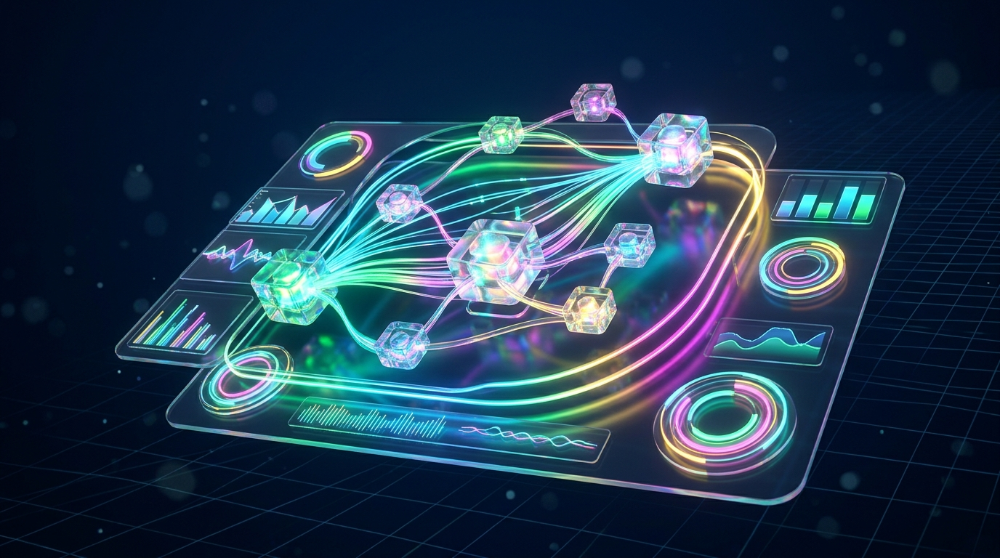
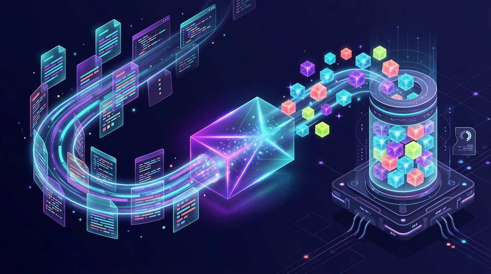
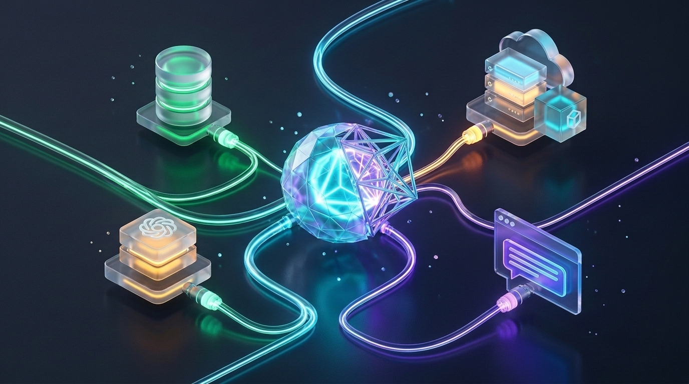

<!--
SEO METADATA
Meta Title: How to Architect Production AI Agents with LangGraph, Hybrid RAG & MCP (2026 Blueprint)
Meta Description: A practical 2026 engineering blueprint for building stateful LangGraph AI agents, zero-hallucination Hybrid RAG pipelines, MCP servers, AI SaaS apps, and high-speed WordPress sites. Backed by Novtek (https://novtek.co.uk/).
Target Keywords: LangGraph Architecture, Hybrid RAG Pipeline, Model Context Protocol MCP, AI SaaS Development, WordPress Speed Optimization, Novtek, Muhammad Abdullah Fiverr
Medium Tags: LangGraph, RAG, Model Context Protocol, AI Automation, Full Stack Development
-->

# How to Architect Production AI Agents with LangGraph, Hybrid RAG & MCP (2026 Engineering Blueprint)

Most AI demos look impressive in a 60-second screen recording—and then collapse the moment real users touch them. Why? Because a single LLM prompt without state management, hybrid retrieval, or structured tool access cannot handle messy real-world data.

In this practical blueprint, we’re breaking down the **exact 4-layer architecture** used by top AI engineering teams—and by **[Novtek](https://novtek.co.uk/)**—to ship reliable, revenue-generating AI applications, automated workflows, and high-converting websites.

---

## Step 1: Replace Fragile Chains with Stateful LangGraph & Hybrid RAG

Traditional linear chains fail whenever an AI needs to retry a step, verify a fact, or route a request to a specialized sub-agent. **LangGraph** solves this by modeling your AI workflow as a cyclic state graph with memory, conditional edges, and human-in-the-loop checkpoints.

Paired with **Hybrid RAG** (combining dense vector similarity in **Pinecone, Qdrant, or pgvector** with BM25 keyword search and a cross-encoder reranker), your agent stops guessing and starts citing exact company data.

### Production Checklist for Your Agent Layer:
- **Chunking Strategy:** Use semantic or parent-child chunking instead of fixed character splits so context isn’t severed mid-sentence.
- **Hybrid Retrieval + Reranking:** Merge semantic vector hits with exact-match keyword results, then rerank the top 20 down to the 5 sharpest chunks.
- **Multi-Model Routing:** Route complex reasoning to **Claude 3.7 Sonnet** or **GPT-4o**, and fast classification/extraction to **Gemini** or lightweight open-source models.

> 💡 **Need a custom multi-agent or RAG system built for your team?** Explore **[Muhammad Abdullah’s AI Automation Gig on Fiverr →](https://www.fiverr.com/mabdullahkh/ai-automation-using-langchain-langgraph-rag-ai-agents)** (featured on **[novtek.co.uk](https://novtek.co.uk/#fiverr-gigs)**).

---

## Step 2: Connect Your AI to Live Databases & APIs Using MCP (Model Context Protocol)

Even the best RAG pipeline only sees *static* documents. What if your AI needs to check live inventory in **PostgreSQL**, update a **CRM** deal, post a summary in **Slack**, or read a **Notion** workspace?

That’s where **Model Context Protocol (MCP)** changes everything. An **MCP server** exposes your live tools, resources, and prompts over a standardized protocol so any compatible AI client (Claude, custom LangChain agents, or your web app) can safely invoke real actions with schema validation.

### What You Can Automate with Custom MCP Servers:
1. **Live Database Copilots:** Let non-technical teams ask natural-language questions against SQL/NoSQL databases with read-only guardrails.
2. **Workspace & CRM Sync:** Automatically enrich leads, summarize support tickets, and sync Notion/Slack updates in real time.
3. **Document Ingestion Pipelines:** Continuously parse PDFs, DOCX, CSVs, and live web pages into your knowledge base.

> 🚀 **Want an AI-native website or custom MCP server?** Check out **[Create AI Websites & Web Apps Using LangChain, RAG & MCP on Fiverr →](https://www.fiverr.com/mabdullahkh/ai-website-ai-web-application-ai-software-as-full-stack-website-developer)** via **[Novtek](https://novtek.co.uk/)**.

---

## Step 3: Package It Into a Monetizable AI SaaS or High-Speed WordPress Platform

Great AI architecture only creates business value when users can actually access it through a fast, trustworthy interface—whether that’s a **custom AI SaaS product** or a **high-converting WordPress business site**.

For SaaS products, pairing a **Python (FastAPI / Django)** AI backend with a **Next.js / React** frontend gives you real-time token streaming, secure authentication, **Stripe subscription billing**, and scalable **AWS** deployment. For content-driven businesses and e-commerce brands, a modern **WordPress / WooCommerce** site tuned with **LiteSpeed Cache / WP Rocket**, **Yoast / Rank Math SEO**, and embedded AI assistants turns organic Google traffic directly into paying customers.

### Choose the Right Build Path for Your Business:
- **Building a Custom AI SaaS / Copilot / Voice Agent?** Launch with **[Develop AI-Powered Web Applications, Custom Software & AI Agents on Fiverr →](https://www.fiverr.com/mabdullahkh/develop-ai-powered-web-applications-custom-software-and-full-stack-websites)**
- **Redesigning Your Business Website, WooCommerce Store, or MERN App?** Book **[Modern WordPress Website Design or Redesign & Full-Stack Dev on Fiverr →](https://www.fiverr.com/mabdullahkh/be-your-mern-stack-developer-with-sql-and-nonsql-databases)**

---

## Ready to Ship Production AI & Full-Stack Software?

Don’t waste months stitching together brittle tutorials. Visit **[https://novtek.co.uk/](https://novtek.co.uk/)** to explore all **4 verified 5.0★ Fiverr services** by **Muhammad Abdullah (`@mabdullahkh`)**—backed by 7+ years of engineering experience and 100% Fiverr milestone protection.

