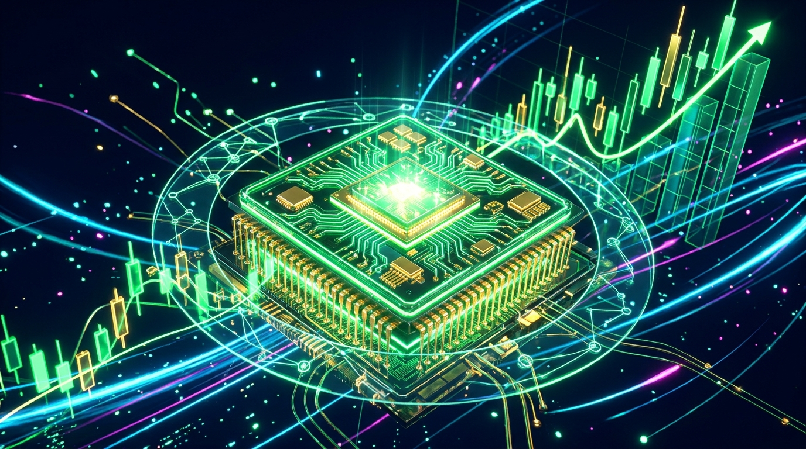
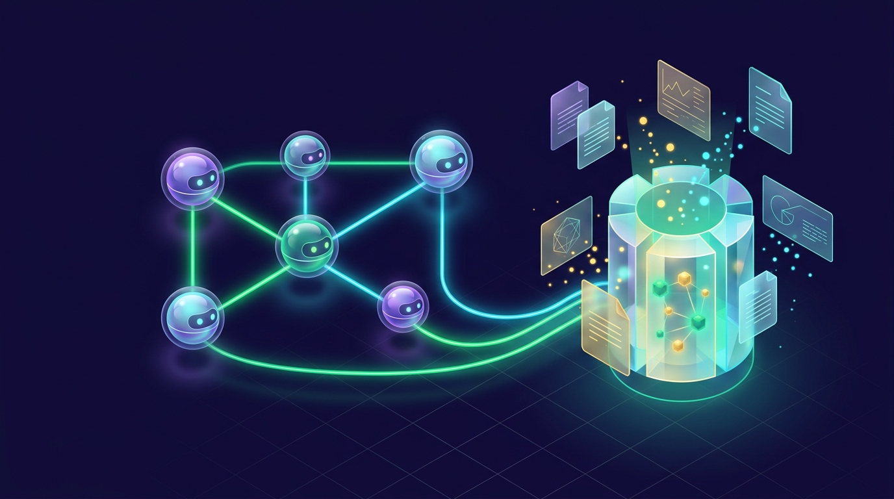
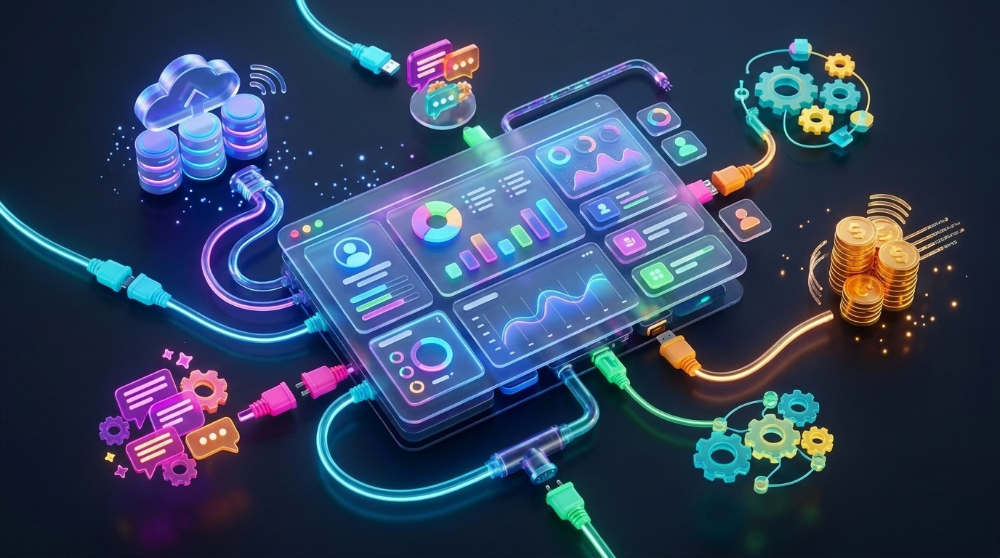
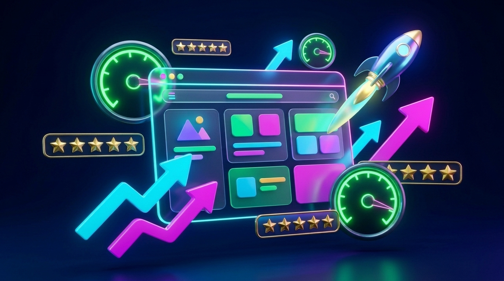

<!--
SEO METADATA
Meta Title: Nvidia Stock Market Surge in 2026: Why Smart Businesses Are Now Investing in Custom AI Agents, RAG & MCP
Meta Description: As Nvidia stock market momentum proves AI demand is unstoppable, discover how businesses are turning GPU-powered AI into real ROI with LangGraph agents, Hybrid RAG, MCP servers, AI SaaS apps, and high-converting WordPress sites via Novtek (https://novtek.co.uk/) and Fiverr (@mabdullahkh).
Target Keywords: nvidia stock market, AI Agents, LangChain, LangGraph, RAG Pipelines, MCP Servers, AI SaaS Web Apps, WordPress Redesign, Novtek, mabdullahkh Fiverr
Medium Tags: Nvidia, Artificial Intelligence, AI Agents, LangChain, SaaS
-->

# Nvidia Stock Market Surge in 2026: Why Smart Businesses Are Now Investing in Custom AI Agents, RAG & MCP

Every time the **Nvidia stock market** ticker spikes, Wall Street celebrates the hardware layer—GPUs, data centers, and inference clusters. But if you’re a founder, agency owner, or product builder, buying chips isn’t how you capture that value.

The real asymmetric upside in 2026 is happening at the **application layer**: turning cheap, ultra-fast LLM inference into **autonomous AI agents**, **custom SaaS products**, and **high-converting websites** that actually generate revenue. That’s the exact gap **[Novtek](https://novtek.co.uk/)**—led by Senior AI & Full-Stack Engineer **Muhammad Abdullah** (**[@mabdullahkh on Fiverr](https://www.fiverr.com/mabdullahkh)**)—helps businesses bridge every day.

---

## 1. From GPU Hype to Real ROI: Autonomous LangGraph & RAG Agents

Hardware only matters when software puts it to work. Companies that win with AI in 2026 aren’t using generic chat windows—they are deploying **stateful multi-agent workflows** built with **LangChain**, **LangGraph**, and **CrewAI**, grounded in **Hybrid RAG** over **Pinecone, Qdrant, or pgvector**.

Instead of hallucinations and manual copy-pasting, your team gets AI agents that search thousands of internal PDFs, DOCX files, and wikis with reranking, call external APIs, and route tasks across **GPT-4o**, **Claude 3.7 Sonnet**, and **Gemini**.

👉 **Want to deploy production AI automation?** Order Gig #1 directly on Fiverr:
**[AI Automation Using LangChain, LangGraph, RAG & AI Agents (@mabdullahkh) →](https://www.fiverr.com/mabdullahkh/ai-automation-using-langchain-langgraph-rag-ai-agents)** (or explore full details on **[novtek.co.uk](https://novtek.co.uk/#fiverr-gigs)**).

---

## 2. MCP Servers & Custom AI SaaS: Turning Intelligence Into Recurring Revenue

As inference costs drop thanks to next-gen compute, **AI SaaS** margins are skyrocketing. Pairing **Model Context Protocol (MCP)** servers with a **Python (FastAPI / Django)** backend and **Next.js / React** frontend lets your AI connect directly to **live PostgreSQL/MongoDB databases, CRMs, Notion, and Slack**—and stream answers in real time behind **Stripe subscription billing**.

Whether you’re launching a new AI startup or embedding an intelligent copilot into your company’s workflow, you can launch fast with 100% Fiverr milestone protection:
- **AI-Native Websites & Live Data Connectors:** **[Create AI Websites & Web Apps Using LangChain, RAG & MCP →](https://www.fiverr.com/mabdullahkh/ai-website-ai-web-application-ai-software-as-full-stack-website-developer)**
- **Full-Stack AI SaaS Platforms & Voice/Chat Copilots:** **[Develop AI-Powered Web Applications, Custom Software & AI Agents →](https://www.fiverr.com/mabdullahkh/develop-ai-powered-web-applications-custom-software-and-full-stack-websites)**

---

## 3. Don’t Waste the Traffic: High-Speed WordPress & Full-Stack Conversion

Riding trending AI demand only pays off if your website loads in under a second, ranks on Google, and converts visitors into buyers. A sluggish, outdated site leaks leads—no matter how smart your backend is.

With **7+ years of full-stack & WordPress experience**, **[Novtek](https://novtek.co.uk/)** builds modern **WordPress** sites (Elementor, Divi, Bricks, Breakdance, WooCommerce, Yoast/Rank Math SEO, LiteSpeed Cache) and **MERN stack** apps with embedded AI assistants, payments, and enterprise security.

👉 **Ready to upgrade your website and capture more leads?** Book Gig #4 on Fiverr:
**[Modern WordPress Website Design or Redesign & Full-Stack Dev →](https://www.fiverr.com/mabdullahkh/be-your-mern-stack-developer-with-sql-and-nonsql-databases)**

---

## Turn AI Momentum Into Your Competitive Advantage

While the market watches the **Nvidia stock market** ticker, smart founders are building the AI agents, MCP integrations, SaaS products, and high-converting websites that customers pay for.

Visit **[https://novtek.co.uk/](https://novtek.co.uk/)** or message **[@mabdullahkh on Fiverr](https://www.fiverr.com/mabdullahkh)** today to start your project with 5.0★ verified quality and 100% Fiverr escrow protection.

