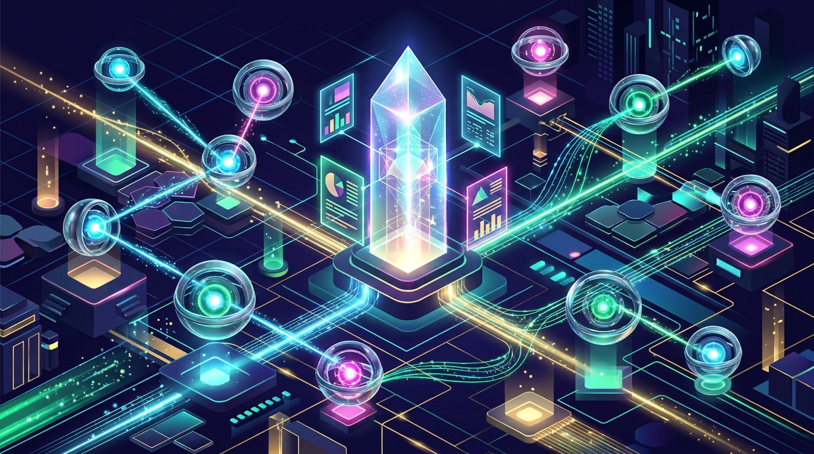

<!--
SEO METADATA
Meta Title: Rockstar Games GTA VI Fever in 2026: What AI Builders & SaaS Founders Can Learn About Autonomous Agents, MCP & Viral Traffic
Meta Description: With Rockstar Games GTA VI dominating global search trends, discover how developers and businesses can build next-gen AI agents (LangGraph & RAG), MCP servers, AI SaaS platforms, and viral-ready WordPress sites via Novtek (https://novtek.co.uk/) and Fiverr (@mabdullahkh).
Target Keywords: rockstar games gta vi, GTA 6, AI Agents, LangGraph, Hybrid RAG, Model Context Protocol MCP, AI SaaS Web Apps, WordPress Speed Optimization, Novtek, mabdullahkh Fiverr
Medium Tags: Gaming, Artificial Intelligence, AI Agents, Web Development, SaaS
-->

# Rockstar Games GTA VI Fever in 2026: What AI Builders & SaaS Founders Can Learn About Autonomous Agents, MCP & Viral Traffic

Right now, **Rockstar Games GTA VI** (**GTA 6**) is dominating global search charts—with millions of players dissecting every trailer detail, map rumor, and next-gen world simulation.

But if you’re a founder, developer, or digital business owner, there’s a massive lesson behind **GTA 6’s** hype: users in 2026 expect **living, intelligent, ultra-fast digital experiences**—and they will flood the platforms that deliver them. That’s the exact standard **[Novtek](https://novtek.co.uk/)**—founded by Senior AI & Full-Stack Engineer **Muhammad Abdullah** (**[@mabdullahkh on Fiverr](https://www.fiverr.com/mabdullahkh)**)—brings to modern AI software and web platforms.

---

## 1. Intelligent Worlds Need Stateful AI: LangGraph & Hybrid RAG Agents

What makes a next-gen open world feel alive? Characters and systems that **remember context, adapt to decisions, and act autonomously**. In business software, static FAQ bots feel like 2015 NPCs—they repeat canned lines and break on real questions.

By combining **LangChain**, **LangGraph**, and **CrewAI** with **Hybrid RAG** over **Pinecone, Qdrant, or pgvector**, your business gets stateful AI agents that reason over thousands of PDFs, docs, and wikis with zero hallucinations—powered by **GPT-4o**, **Claude 3.7 Sonnet**, and **Gemini**.

👉 **Build your own intelligent AI agents:** Order Gig #1 on Fiverr:
**[AI Automation Using LangChain, LangGraph, RAG & AI Agents (@mabdullahkh) →](https://www.fiverr.com/mabdullahkh/ai-automation-using-langchain-langgraph-rag-ai-agents)** (or view all services at **[novtek.co.uk](https://novtek.co.uk/#fiverr-gigs)**).

---

## 2. Real-Time World State: MCP Servers & Custom AI SaaS Platforms

Just like a live game engine syncs player actions with world state in milliseconds, modern **AI SaaS** apps need **Model Context Protocol (MCP)** to connect LLMs directly to **live PostgreSQL/MongoDB databases, CRMs, Slack, Notion, and APIs**.

Pairing **Python (FastAPI / Django)** AI backends with **Next.js / React** frontends, real-time streaming, and **Stripe subscription billing** turns your AI idea into a scalable, recurring-revenue product:
- **AI-Native Websites & Live MCP Connectors:** **[Create AI Websites & Web Apps Using LangChain, RAG & MCP →](https://www.fiverr.com/mabdullahkh/ai-website-ai-web-application-ai-software-as-full-stack-website-developer)**
- **Full-Stack AI SaaS Platforms & Copilots:** **[Develop AI-Powered Web Applications, Custom Software & AI Agents →](https://www.fiverr.com/mabdullahkh/develop-ai-powered-web-applications-custom-software-and-full-stack-websites)**

---

## 3. Surviving Viral Traffic Spikes: High-Speed WordPress & Full-Stack Dev

When a massive trend like **GTA 6** hits, slow websites crash and lose 90% of their visitors. Whether you’re running a gaming/tech media brand, an e-commerce store, or a B2B SaaS landing page, **sub-second speed and technical SEO** are what turn viral clicks into paying customers.

With **7+ years of experience**, **[Novtek](https://novtek.co.uk/)** engineers lightning-fast **WordPress** websites (Elementor, Divi, Bricks, Breakdance, WooCommerce, Yoast/Rank Math SEO, LiteSpeed Cache) and **MERN stack** web apps built to handle traffic spikes effortlessly.

👉 **Upgrade your site before your next launch:** Book Gig #4 on Fiverr:
**[Modern WordPress Website Design or Redesign & Full-Stack Dev →](https://www.fiverr.com/mabdullahkh/be-your-mern-stack-developer-with-sql-and-nonsql-databases)**

---

## Ready to Level Up Your Tech Stack?

Visit **[https://novtek.co.uk/](https://novtek.co.uk/)** or message **[@mabdullahkh on Fiverr](https://www.fiverr.com/mabdullahkh)** today to launch your AI agents, MCP integrations, SaaS app, or high-converting website with 5.0★ verified quality and 100% Fiverr escrow protection.

