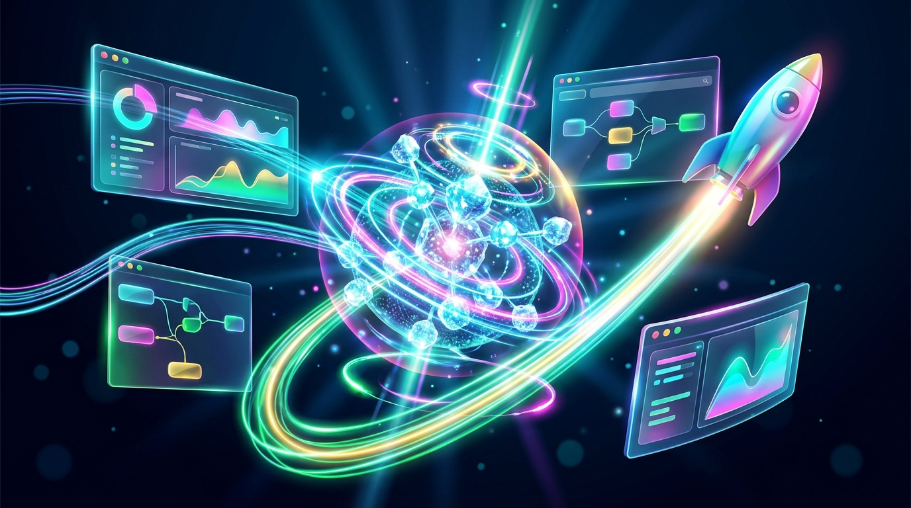
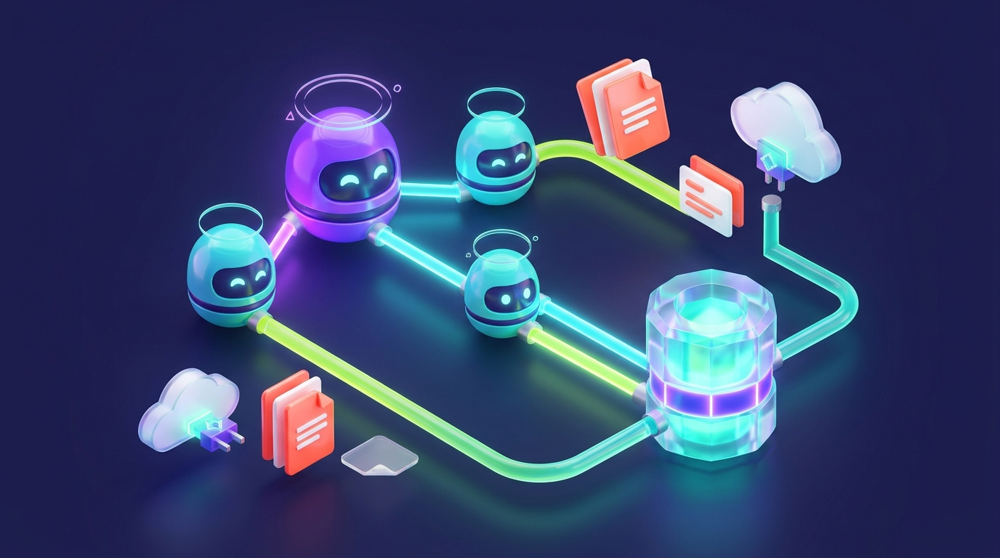

<!--
SEO METADATA
Meta Title: Why 90% of Businesses Will Replace Manual Workflows with AI Agents & MCP in 2026
Meta Description: Discover how LangChain, LangGraph, RAG pipelines, MCP servers, custom AI SaaS apps, and modern WordPress websites are transforming business automation. Explore Muhammad Abdullah's 4 verified Fiverr services at Novtek (https://novtek.co.uk/).
Target Keywords: AI Automation, LangChain, LangGraph, RAG Pipelines, MCP Server Development, Custom AI Web Apps, AI SaaS Developer, Modern WordPress Design, Novtek
Medium Tags: Artificial Intelligence, LangChain, AI Agents, Web Development, SaaS
-->

# Why 90% of Businesses Will Replace Manual Workflows with AI Agents & MCP in 2026 (And How to Build Yours Today)

Let’s be brutally honest: **basic prompt-and-reply chatbots are already obsolete.**

In 2026, businesses that are winning aren’t just pasting prompts into ChatGPT. They are deploying **autonomous AI agents** that read live company documents, query SQL/NoSQL databases in real time, trigger APIs via **Model Context Protocol (MCP)**, and run inside high-converting **AI SaaS web apps** and **WordPress platforms**.

If your competitors are automating customer support, lead qualification, internal knowledge search, and full-stack software workflows while your team is still doing copy-paste busywork, you’re leaving serious revenue on the table.

That’s exactly why **[Novtek](https://novtek.co.uk/)**—founded by Senior AI Application & Full-Stack Engineer **Muhammad Abdullah** (`@mabdullahkh`, 7+ years experience)—is helping founders, agencies, and enterprises turn cutting-edge AI into production-ready software.

Below, we break down the **4 game-changing tech pillars** powering modern business growth—and how you can launch any of them with **100% Fiverr escrow protection** via **[Novtek’s official Fiverr showcase](https://novtek.co.uk/#fiverr-gigs)**.

---

## 1. The Secret Weapon: Autonomous AI Agents, LangGraph & Enterprise RAG

Single-prompt LLM wrappers hallucinate and break in production. Real businesses need **stateful, tool-calling multi-agent workflows** that reason, verify, and execute reliably.

Using **LangChain**, **LangGraph**, **CrewAI**, and hybrid **Retrieval-Augmented Generation (RAG)** backed by vector databases like **Pinecone, Qdrant, and pgvector**, you can build AI systems that actually know your business inside out:
- **Zero-Hallucination Document Search:** Query thousands of PDFs, DOCX files, CSVs, and internal wikis with hybrid search and reranking.
- **Multi-Agent Orchestration:** Delegate research, validation, and execution across specialized agents using LangGraph state machines.
- **Custom Tool Calling & APIs:** Connect OpenAI GPT-4o, Claude 3.7 Sonnet, Gemini, or open-source LLMs directly to your existing backend tools.

👉 **Want this built for your business?** Check out Gig #1 on **[Novtek](https://novtek.co.uk/)**:
**[AI Automation Using LangChain, LangGraph, RAG & AI Agents on Fiverr →](https://www.fiverr.com/mabdullahkh/ai-automation-using-langchain-langgraph-rag-ai-agents)**

---

## 2. Model Context Protocol (MCP): Connecting AI Directly to Your Live Data

If RAG gives AI a memory, **MCP (Model Context Protocol)** gives AI **hands**.

Instead of brittle one-off glue scripts, custom **MCP servers and clients** let Claude, ChatGPT, and custom web agents securely talk to your live databases, CRM, Notion, Slack, and internal APIs in real time.

Imagine an **AI-native website or internal dashboard** where your team or customers can ask a question and the AI:
1. Pulls live records from PostgreSQL or MongoDB,
2. Cross-references your knowledge base via RAG, and
3. Executes actions across your workspace—all through a clean, modern web interface.

👉 **Ready to connect your LLMs to real-world tools?** Explore Gig #2 featured on **[novtek.co.uk](https://novtek.co.uk/)**:
**[Create AI Websites & Web Apps Using LangChain, RAG & MCP on Fiverr →](https://www.fiverr.com/mabdullahkh/ai-website-ai-web-application-ai-software-as-full-stack-website-developer)**

---

## 3. Turning AI Into Recurring Revenue: Custom AI SaaS & Full-Stack Web Apps

Have an AI startup idea or need an internal enterprise portal? A Jupyter notebook won’t pay the bills—you need a **scalable, fast, production-deployed web application**.

Combining **Python (FastAPI / Django)** AI backends with **Next.js / React** frontends unlocks:
- **Real-Time Streaming UX:** Instant token-by-token responses for AI copilots, chatbots, and voice agents.
- **Monetization Ready:** Built-in authentication, user dashboards, and **Stripe subscription billing**.
- **Cloud Scalability:** Deployed cleanly on AWS or modern cloud infrastructure with clean, maintainable code.

👉 **Launch your own AI SaaS product:** Order Gig #3 via **[Novtek](https://novtek.co.uk/)**:
**[Develop AI-Powered Web Applications, Custom Software & AI Agents on Fiverr →](https://www.fiverr.com/mabdullahkh/develop-ai-powered-web-applications-custom-software-and-full-stack-websites)**

---

## 4. High-Converting WordPress & Full-Stack Websites (Built for Speed, SEO & AI)

Even the smartest AI product fails if your main website looks outdated, loads slowly, or doesn’t rank on Google.

Whether you need a complete **WordPress redesign**, a high-converting **WooCommerce store**, or a **MERN full-stack web application** backed by SQL/NoSQL databases, performance and SEO are non-negotiable:
- **Modern Builders & Custom Code:** Elementor, Divi, Bricks, Breakdance, Astra, Kadence, and Crocoblock—plus custom React/Node.js when needed.
- **E-Commerce & Monetization:** WooCommerce, Stripe, PayPal, LearnDash, Tutor LMS, Dokan, and ACF.
- **Speed & Technical SEO:** Yoast SEO, Rank Math, WP Rocket, LiteSpeed Cache, Wordfence security, and embedded AI assistants.

👉 **Upgrade your online presence:** Book Gig #4 on **[Novtek](https://novtek.co.uk/#fiverr-gigs)**:
**[Modern WordPress Website Design or Redesign & Full-Stack Dev on Fiverr →](https://www.fiverr.com/mabdullahkh/be-your-mern-stack-developer-with-sql-and-nonsql-databases)**

---

## Why Founders & Agencies Choose Novtek

When you hire **[Muhammad Abdullah at Novtek](https://novtek.co.uk/)**, you aren’t gambling on unproven templates:
- **7+ Years of Full-Stack & AI Engineering Experience**
- **5.0★ Verified Quality on Fiverr (`@mabdullahkh`)**
- **100% Fiverr Milestone & Escrow Protection**
- **End-to-End Delivery:** From LangGraph & MCP architecture to React/Next.js, WordPress, SEO, and cloud deployment.

### Ready to Automate, Scale, and Outpace Your Competition?

Visit **[https://novtek.co.uk/](https://novtek.co.uk/)** today to explore all 4 services, read technical guides, and start your project directly on Fiverr!

